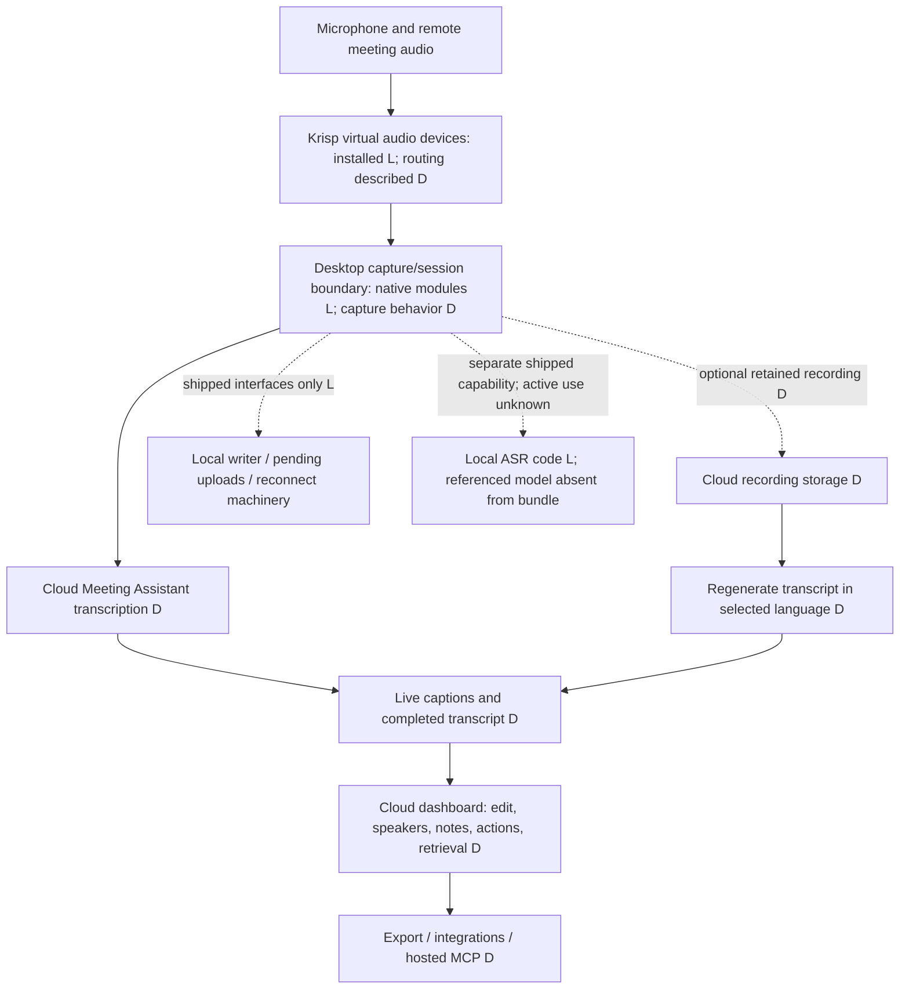

# Krisp transcription workflow: gap analysis for Anarlog

Research date: 2026-10-24. Scope: transcription and the surrounding meeting workflow. No implementation, benchmark, app launch, account operation, audio capture, or production-data access was performed. Noise suppression, accent correction, and audio enhancement are outside scope.

## Main finding

Keep Anarlog and improve completion reliability and reviewability before replacing its ASR engine. This checkout already implements local capture, word timing, speaker assignment, transcript editing, search, recovery, and automatic summaries. The observed user problem is that those capabilities have not yet produced a verified complete workflow: three raw TXT/SRT outputs exist, but zero of three meeting cards have summaries. A healthy ASR or LLM endpoint alone does not prove that a meeting reached a durable ready state.

Krisp's useful product pattern is a connected workflow: capture → live text → reviewed transcript → structured notes/actions → retrieval/export. Its documented Meeting Assistant uses cloud transcription. Inspection of the desktop bundle cannot identify its production cloud ASR model or explain its perceived accuracy. No quality superiority was measured here.

## Evidence boundaries

- **L — locally confirmed:** installed bundle metadata, resources, dependency declarations, native linkage, or identifiers observed by static inspection. This proves shipped material, not runtime activation or entitlement.
- **D — documentation confirmed:** official Krisp documentation available on the research date. Cloud features can change independently of desktop version and depend on plan/workspace configuration.
- **A — Anarlog source confirmed:** current source in this checkout, based at `2a40e41654a4635550ead51af23137608bd8422d`, with pre-existing uncommitted work. Source capability is not proof of the installed app's behavior.
- **U — user-provided operational context:** carried forward from the parent conversation; not revalidated against databases or meeting contents.
- **H — hypothesis/proposal:** a design opportunity or possible explanation requiring separate validation.

**U:** three raw TXT/SRT outputs for 23 October; cards 0/3 without summaries; ASR on port 8765 and Ollama on 11434 reported alive; new-recording end-to-end behavior unconfirmed. Obsidian export remains `prepared_not_applied`, with zero Markdown files. Import/GUI/headless extension work is explicitly deferred. None of these operations was resumed.

Existing working-tree changes were preserved. No Codex session directories, user meeting records, credentials, application-support databases, or private network traffic were inspected. No proprietary source, model, or resource was copied into the repository. This report describes behavior and boundaries in original prose; it is not a recovered implementation specification.

## Installed application and safe static findings

The installed app is `~/Applications/krisp.app`, not Crisp support chat.

| Finding                                                                                                     | Evidence and interpretation                                                                                                                                                                                                                                                                                                                                                                                             |
| ----------------------------------------------------------------------------------------------------------- | ----------------------------------------------------------------------------------------------------------------------------------------------------------------------------------------------------------------------------------------------------------------------------------------------------------------------------------------------------------------------------------------------------------------------- |
| **L:** version `3.18.3`; identifier `ai.krisp.krispMac`; minimum macOS `12.0`                               | `Contents/Info.plist`. Main executable is arm64.                                                                                                                                                                                                                                                                                                                                                                        |
| **L:** publisher metadata says **Krisp Technologies, Inc.**                                                 | `Resources/app.asar` package manifest; official help also carries that company name. Code-signing metadata reports team `U5R26XM5Z2`, but `codesign -dvv` returned `Authority=(unavailable)`; publisher certificate trust was not independently established.                                                                                                                                                            |
| **L:** Electron/React application with native modules                                                       | Manifest and `Frameworks`; native modules include media processing, audio-device management, integration hub, native utilities, and logging. This differs from Anarlog's Tauri/Rust frontend boundary; there is no reason to migrate frameworks.                                                                                                                                                                        |
| **L:** virtual audio driver is installed                                                                    | `/Library/Audio/Plug-Ins/HAL/KrispAudio.driver`, version `2.1.8`, identifier `ai.krisp.krispMac.audioDriver`. Installation does not prove current routing.                                                                                                                                                                                                                                                              |
| **L:** native media module links CoreAudio, AudioToolbox, CoreMedia, ScreenCaptureKit, and network wrappers | `otool -L` on `kr-media-sp.node`. These are available capture/transport building blocks, not evidence of which capture API any particular meeting uses.                                                                                                                                                                                                                                                                 |
| **L:** diarization model resource exists                                                                    | `resources/models/audio/models.json` references `diar_2.0.0_1.0.kef`, and that file exists. Native symbols also include diarization configuration. No model contents were decoded; the deployed diarization route is unknown.                                                                                                                                                                                           |
| **L:** local ASR machinery is shipped                                                                       | Native symbols include ASR processor/decoder families; the JS bundle has local/remote ASR modes and model-loader interfaces. Metadata references `asr_eng_6.3.0_1.0.kef`, but that file is absent from the inspected bundle model directory. This does not establish whether a model was downloaded elsewhere, whether local ASR is available to this account, or whether it serves Meeting Assistant.                  |
| **L:** reliability-related interfaces are shipped                                                           | Identifier families include a live-transcript writer, pending-upload database, multipart uploader, upload-queue state, upload retry limits/backoff, remote-ASR reconnect, and recovery backups. The manifest includes `nedb-promises`, `retry`, Socket.IO, gRPC, and Sentry. This suggests durable workflow machinery (**H**), but does not prove transactional guarantees, restart replay, or the actual retry policy. |

Method: read selected plist/manifest fields; parse the ASAR directory and inspect metadata/interface names in memory; list shipped resources; inspect native exported symbols with `nm` and dependencies with `otool`. Nothing was executed from Krisp. Full native decompilation was unnecessary for these conclusions and would not reveal a remote service's implementation. No additional tools were installed.

Reproduction fingerprint: `Resources/app.asar` SHA-256 `aa9a4b9aec50a3348bf36053df8b4cfb7a929adde51d2f481b693e0c52e09efb`; `kr-media-sp.node` SHA-256 `46782bf5e9a06275b0bfc57d48e5f1abca43eebf528ee518b0d457c9f54c3365`.

## Local/cloud pipeline and what remains invisible

Arrows describe product-level flow, not a verified protocol trace. Exact chunking, stream topology, endpoint selection, on-device versus server diarization split, and server-side model/provider remain unknown. Socket.IO, gRPC, ONNX Runtime notices, and decoder symbols do **not** establish the production ASR engine. Nor does a local model filename prove that cloud inference uses the same model.

**D:** Krisp explicitly says Meeting Assistant transcription happens in the cloud and its transcription input is deleted after processing; separately retained recordings are stored in the cloud. Do not conflate that claim with deletion of transcripts, summaries, or recordings. See [cloud data](https://help.krisp.ai/hc/en-us/articles/360012035500-What-data-Krisp-sends-to-the-cloud).

## Feature comparison

| Workflow                 | Krisp, documented unless marked otherwise                                                                                                                                                                                                                                                                                           | Anarlog, source-confirmed unless marked otherwise                                                                                                                                                                                                                                                                     | Practical gap                                                                                                                                                          |
| ------------------------ | ----------------------------------------------------------------------------------------------------------------------------------------------------------------------------------------------------------------------------------------------------------------------------------------------------------------------------------- | --------------------------------------------------------------------------------------------------------------------------------------------------------------------------------------------------------------------------------------------------------------------------------------------------------------------- | ---------------------------------------------------------------------------------------------------------------------------------------------------------------------- |
| Capture/session UX       | Live captions, pause, transcribe-only/audio/screen modes; guidance to route both Krisp mic and speaker. [Recording](https://help.krisp.ai/hc/en-us/articles/30146816045980-Record-your-meetings-with-Krisp-AI-Note-Taker)                                                                                                           | Separate microphone/system capture; macOS system route uses a CoreAudio process tap. [Capture source](../../crates/audio-actual/src/speaker/macos.rs)                                                                                                                                                                 | Verify both sides and session continuity; copying Krisp's virtual-driver design is unnecessary.                                                                        |
| Live and batch           | Live captions plus single-file audio/video upload with language selection. [Upload](https://help.krisp.ai/hc/en-us/articles/16411029727260-Upload-and-transcribe-audio-video-files-with-Krisp)                                                                                                                                      | Batch and live paths exist, including provider selection. [Batch](../../apps/desktop/src/stt/useRunBatch.ts), [providers](../../apps/desktop/src/settings/ai/stt/shared.tsx)                                                                                                                                          | Quality/completion evidence, not a missing batch concept. Deferred import changes remain deferred.                                                                     |
| Languages/code-switching | Help upload page lists 16 languages including Russian; [marketing](https://krisp.ai/meeting-transcription/) says 17. Auto-detection and regeneration with a selected language are documented. [Regeneration](https://help.krisp.ai/hc/en-us/articles/30556630438684-Regenerate-your-meeting-transcripts)                            | Language/model support depends on selected provider; there is no universal cross-provider promise. [Providers](../../apps/desktop/src/settings/ai/stt/shared.tsx)                                                                                                                                                     | Neither source proves accurate RU↔EN intra-sentence switching. Test it explicitly; do not equate translation with code-switch preservation.                            |
| Speakers/timestamps      | Calendar-assisted naming, speaker timeline/talk time, speaker/timestamp TXT. [Dashboard](https://help.krisp.ai/hc/en-us/articles/10291109632412-Meetings-page-in-account-dashboard)                                                                                                                                                 | Word IDs, start/end times, channel and speaker index; manual speaker assignment and segment playback. [Word contract](../../crates/transcript/src/types/word.rs), [speaker UI](../../apps/desktop/src/session/components/note-input/transcript/renderer/speaker-assign.tsx)                                           | Preserve identity/timing through reruns and edits; distinguish source channel from individual remote speakers.                                                         |
| Editing/review           | Block editing, find/replace, comments, vocabulary. [Editing](https://help.krisp.ai/hc/en-us/articles/30555560342044-Edit-your-meeting-transcripts)                                                                                                                                                                                  | Segment editing, speaker changes and search UI with case/whole-word options already exist. [Segments](../../apps/desktop/src/session/components/note-input/transcript/renderer/segment.tsx), [search UI](../../apps/desktop/src/session/components/note-input/search/bar.tsx)                                         | Establish which replace operations affect transcript versus note; verify edit protection during regeneration. Source UI controls alone do not prove end-to-end parity. |
| Summaries/actions        | Automatic default template, regeneration and editable actions; customizable note blocks. [Summaries](https://help.krisp.ai/hc/en-us/articles/30558484794780-Summarize-your-meetings-with-Krisp), [templates](https://help.krisp.ai/hc/en-us/articles/26708055686044-Meeting-Notes-Templates)                                        | Summary service, pending-job storage, retries, templates and automation exist. [Enhancer](../../apps/desktop/src/services/enhancer/index.ts), [storage](../../apps/desktop/src/services/enhancer/storage.ts)                                                                                                          | **U:** 0/3 summary cards is the immediate acceptance gap; cause remains undiagnosed.                                                                                   |
| Search/AI retrieval      | Meeting/folder/archive-scoped AI chat with history. [AI Chat](https://help.krisp.ai/hc/en-us/articles/18440374735644-Get-meeting-insights-with-Krisp-AI-Chat)                                                                                                                                                                       | Desktop search uses Tantivy; meeting-search chat tools and local CLI/MCP already exist. [Search engine](../../apps/desktop/src/search/contexts/engine/index.tsx), [chat tool](../../apps/desktop/src/chat/tools/search-meetings.ts), [MCP](../../apps/cli/src/mcp.rs)                                                 | Improve passage-level citations and index consistency rather than add another search engine.                                                                           |
| Export/integrations      | TXT transcripts, MP3 recordings, multiple external integrations and hosted MCP. [Export](https://help.krisp.ai/hc/en-us/articles/30553368057884-Access-your-meetings), [integrations](https://help.krisp.ai/hc/en-us/sections/30529930009628-Integrations), [MCP](https://help.krisp.ai/hc/en-us/articles/25396920405148-Krisp-MCP) | Local Markdown and automation integrations exist. Existing file identity is checked, then owned Markdown is atomically replaced. [Exporter](../../plugins/local-api/src/commands.rs)                                                                                                                                  | Protect manual edits within owned files. **U:** Obsidian application is still deferred and has produced no MD.                                                         |
| Recovery/status          | **L:** queue/retry/reconnect identifiers. Official [troubleshooting](https://help.krisp.ai/hc/en-us/articles/14566518239132-AI-Meeting-Assistant-Error-messages-and-their-explanations) does not specify crash durability.                                                                                                          | Live transcript journal, capture recovery, batch resume and pending-summary replay already exist. [Journal](../../plugins/transcription/src/live_journal.rs), [capture recovery](../../apps/desktop/src/stt/live-capture-recovery.tsx), [batch recovery](../../apps/desktop/src/stt/batch-transcription-recovery.tsx) | Expose and verify stage completion and terminal errors; no evidence justifies saying Krisp is more crash-safe.                                                         |

Krisp's [recording FAQ](https://help.krisp.ai/hc/en-us/articles/12216182124956-FAQ-about-Krisp-Recording-feature) also documents a 30-second minimum and four-hour maximum. These are product limits, not targets Anarlog should copy. Documentation presence is not a successful test of this installed version or this account.

## Prioritized clean-room recommendations

Estimates are relative: S = localized change; M = several existing modules plus regression coverage; L = broader data/UI contract. These are proposed future tasks, not authorization to start implementation now.

1. **P0 — Make meeting completion observable. Benefit: highest; effort M.** Show separate capture, transcript persistence, summary and export states, last error, next retry and a safe retry action. Depend on existing session/recovery/enhancer contracts, not endpoint health alone. **Accept:** in a disposable fixture, every job reaches ready or an actionable failed state; restarting between stages produces one canonical transcript/summary and no silent stall. A summary failure never hides a saved transcript. This is an improvement to existing machinery, not a proposed replacement queue.

2. **P0 — Establish the ASR quality baseline before choosing a model. Benefit: highest; effort M.** Compare current local configuration against Krisp on the consented test set below; pin the exact model and decoding configuration. **Dependencies:** reference annotations and separate approval to run tests. **Accept:** per-slice WER/CER, entity accuracy, speaker error, latency and completion results are recorded; choose a replacement only for a measured improvement without an unacceptable privacy/hardware tradeoff.

3. **P1 — Verify crash-safe stage handoff and bounded retries. Benefit: high; effort M–L.** Exercise existing live journal, batch resume and pending-summary replay; close only demonstrated gaps. Use durable job identity, input revision, bounded retry/backoff, transient/permanent error classification and an explicit terminal state. **Dependencies:** lifecycle/storage ownership and fault injection in disposable data. **Accept:** terminate after capture, during ASR, after transcript persistence and during summary save; restart loses no acknowledged transcript, creates no duplicate artifact, preserves user edits, and never retries an auth/configuration failure forever.

4. **P1 — Add explicit RU/EN/code-switch policy and controlled regeneration. Benefit: high; effort M.** Expose provider capabilities and chosen language mode, retain original-language text, and offer versioned reruns only when retained audio permits them. **Dependencies:** capability contract, audio retention and transcript revisioning. **Accept:** RU/EN switches and technical names survive the agreed evaluation set; unavailable language modes explain their limitation; reruns keep the previous version and never silently replace manual corrections.

5. **P1 — Preserve speaker identity and timing through review. Benefit: high; effort M.** Build on existing channel/speaker/word contracts and assignment UI; add a reviewable timeline if useful. Treat mic-versus-system separation as channel attribution, not full remote-speaker diarization. **Dependencies:** provider speaker/timing output and overlap policy. **Accept:** rename/split/merge changes survive restart/export; speaker IDs remain stable across segments; measured diarization and seek error stay within the predeclared benchmark budget, with overlap reported separately.

6. **P1 — Make summaries and action items auditable. Benefit: high; effort M.** Extend current templates with source-segment references and structured optional owner/due-date fields; allow unknown values instead of invention. Track the transcript revision used to produce a summary. **Dependencies:** stable segment IDs and current LLM/enhancer service. **Accept:** evaluators can trace each decision/action to evidence; fabricated owners/deadlines are zero on the test set; transcript correction marks derived notes stale instead of silently rewriting them. Existing user notes survive regeneration.

7. **P2 — Make export safe for edited notes. Benefit: high for this user; effort M.** Independently design an opt-in managed section, sidecar, or conflict-copy contract using content hashes and atomic writes. This addresses the confirmed whole-owned-file replacement behavior; it does not assume Krisp has a solution. **Dependencies:** explicit ownership/version policy and filesystem fixtures. **Accept:** export twice is idempotent; edits outside the managed region survive; edits inside it produce an explicit conflict; a failed write leaves the prior file readable. No exporter or Obsidian workflow is applied in this research.

8. **P2 — Improve evidence-based retrieval and integrations. Benefit: medium–high; effort M.** Reuse Tantivy and existing CLI/MCP; return meeting, speaker, timestamp and transcript revision with each passage. Keep outbound integrations explicit and separately configured. **Dependencies:** index refresh after edits and stable passage identities. **Accept:** a synthetic query opens the exact passage/audio offset; deleted/edited text is reflected in search; local retrieval works without cloud access. Hosted integration parity is not required to obtain this benefit.

## Independent implementation options

These are alternatives to evaluate, not components inferred from Krisp or instructions to install anything.

| Need                  | Independent option                                                                                                                  | Fit and constraints                                                                                                                                                                                                                                                                                                                                                     |
| --------------------- | ----------------------------------------------------------------------------------------------------------------------------------- | ----------------------------------------------------------------------------------------------------------------------------------------------------------------------------------------------------------------------------------------------------------------------------------------------------------------------------------------------------------------------- |
| Local ASR on Mac      | [whisper.cpp](https://github.com/ggml-org/whisper.cpp), MIT                                                                         | Apple Silicon/Metal/Core ML support. Reuse Anarlog's existing local provider seam first. Benchmark a specific model/quantization; no blanket quality claim.                                                                                                                                                                                                             |
| Batch ASR service     | [faster-whisper](https://github.com/SYSTRAN/faster-whisper), MIT                                                                    | Word timestamps and a separate inference service. Hardware/backend suitability on this Mac must be checked; do not assume CUDA or Metal equivalence.                                                                                                                                                                                                                    |
| Alignment/diarization | [WhisperX](https://github.com/m-bain/whisperX), BSD-2-Clause, and [pyannote.audio](https://github.com/pyannote/pyannote-audio), MIT | Optional independent components; language-specific alignment, overlap and diarization errors remain. Code licenses do not automatically cover all downloaded weights/dependencies. [Community-1](https://huggingface.co/pyannote/speaker-diarization-community-1) has its own CC-BY-4.0 license/access conditions; review attribution, access and telemetry before use. |
| Retrieval             | Existing Tantivy in Anarlog; [SQLite FTS5](https://sqlite.org/fts5.html) only for an isolated alternative prototype                 | Local lexical search needs no cloud model. Do not replace working Tantivy or add a second production index without evidence.                                                                                                                                                                                                                                            |
| Jobs/edit-safe export | Existing Rust/SQLite lifecycle plus original job-state and file-ownership contracts                                                 | No Krisp dependency or proprietary algorithm is needed. Any production schema change must follow Anarlog migration and compatibility rules.                                                                                                                                                                                                                             |

ASR, diarization, alignment, summary generation and retrieval should remain separately measurable interfaces. A better ASR model cannot fix a missing summary handoff, export conflict, or unreported failed job.

## Fair quality comparison, not run in this task

1. Create a new, consented, non-confidential 60–90 minute evaluation corpus: short and long synthetic meetings, RU, EN, between-sentence and intra-sentence RU/EN switching, domain names/numbers/dates, multiple speakers, pauses and overlap. Prefer staged volunteer speech; TTS-only results need a separate label and cannot establish human-speech quality. Reserve a held-out portion before tuning. Never upload the user's real meetings.
2. Annotate verbatim original-language reference words, speaker turns, representative word boundaries, decisions and actions. Record conventions for punctuation, hesitations, transliteration and mixed-script names. Use two reviewers for disputed entities/speaker turns.
3. First compare **identical file input** in batch where both products support it. Separately evaluate live capture with the same staged meeting and matched audio routing/levels. Do not compare Krisp batch against Anarlog live and attribute the difference solely to ASR. Keep enhancement settings fixed and disclose them as a confound; this research does not study DSP.
4. Record Krisp desktop version, web settings, language, capture mode and plan-visible capability; record Anarlog source/build, provider, model hash/version, prompt/dictionary, decoding settings, hardware and audio format. Krisp's cloud model remains unpinned unless the vendor supplies it; record test date and repeat at least three times.
5. Score normalized WER and CER per language/code-switch slice, names/numbers accuracy, speaker-attributed WER and diarization error with explicit overlap/collar conventions, timing error on annotated boundaries, and unsupported text during silence. Report micro and per-clip results; do not let long English clips hide Russian failures.
6. Measure first-text latency, stable-text latency, finalization time, real-time factor, RAM/CPU, failure/completion rate, and time until a usable summary. Blind-score decisions/actions for evidence, omission, hallucination, owners and dates; log the prompt/template and reference transcript quality separately.
7. In disposable test sessions only, test stop/start, offline/reconnect, restart at each stage, unavailable provider and duplicate retry. For Krisp, use supported UI/OS operations without tampering or bypass; report observed behavior, not assumptions from shipped identifiers. Define success budgets before running, report confidence/variance, and preserve failures.

No benchmark recordings, annotations, outputs or new transcriptions were generated here. The three existing outputs are operational context, not a consented cloud benchmark corpus.

## Remaining unknowns and verification

- No runtime UI/account verification was needed; screen lock was not bypassed. Installed-version feature availability, entitlement, routing and end-to-end quality remain untested.
- Krisp cloud ASR identity, training data, decoder details, exact queue durability and on-device/cloud diarization split remain unknown. More binary inspection cannot by itself prove those cloud facts.
- Anarlog's reported 0/3 summary outcome is not diagnosed here. Existing recovery/source code should not be described as absent, nor as proven healthy.
- No Linear tools are available in this environment; no tracker writes were attempted. The fork rules also do not authorize unsolicited tracker publication. Durable findings remain in this requested local report.
- No app/config/database edits, tool installation, commit, push, or external-message operation was performed. Only this report was created; pre-existing changes are outside its scope.

### Report verification

- `node_modules/.bin/dprint fmt --allow-no-files docs/research/krisp-transcription-gap-analysis-2026-10-24.md` formatted this file. The initial incremental-cache write was blocked outside the workspace; `node_modules/.bin/dprint check --incremental=false --allow-no-files docs/research/krisp-transcription-gap-analysis-2026-10-24.md` subsequently passed without that write.
- All 17 relative source links resolve. Markdown is associated with the repository formatter. This research file was not added as a published Mintlify navigation page; no documentation deployment occurred.
- `python3 .github/scripts/test_check_license_boundary.py` passed (9 tests); `python3 .github/scripts/check_license_boundary.py` passed.
- The full `node --test` invocation from `.github/workflows/ci.yaml` ran: 94 passed, 1 failed. Failure: `plugin package mirrors the canonical skill and license`, at `scripts/publish-anarlog-skill.test.mjs:32`, because the existing changed `skills/anarlog/references/cli.md` differs from its packaged mirror. That file was already modified before this task; no fix was applied to unrelated work. Full output is in `/tmp/krisp-research-ci.log`. This is not a complete passing CI result.
- `pnpm` is absent from PATH; existing `node_modules/.bin/dprint` was used directly. `zizmor` is not installed as a standalone command. `uvx zizmor --format sarif .` was not run because resolving it could install a tool, which this task does not authorize. If that general repository gate is required later, use the upstream [zizmor installation instructions](https://docs.zizmor.sh/installation/) and provide read-only GitHub access. No workflow or action file changed in this task.
